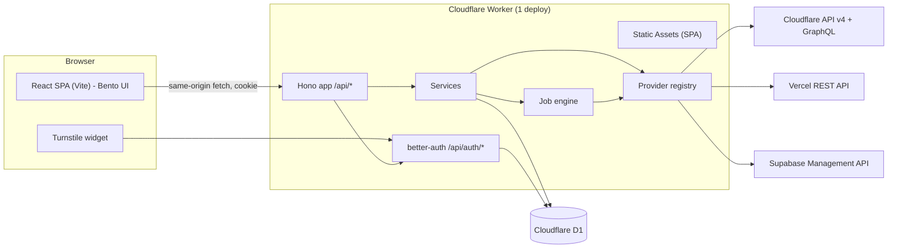
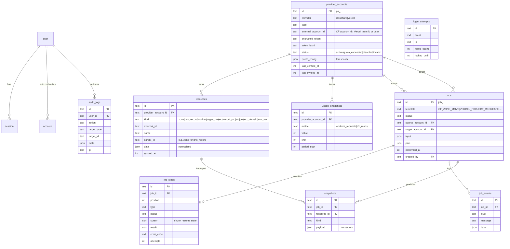
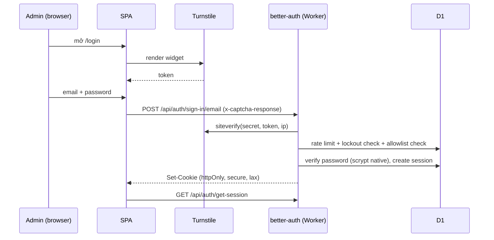
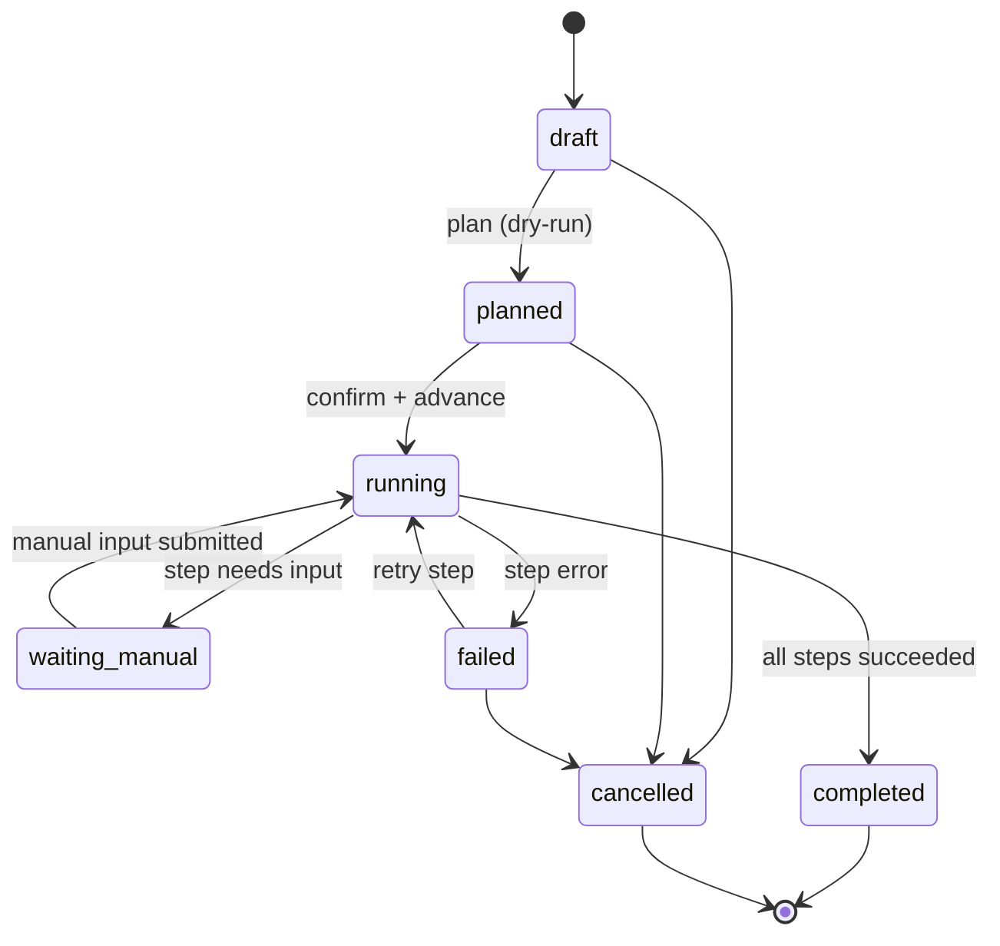
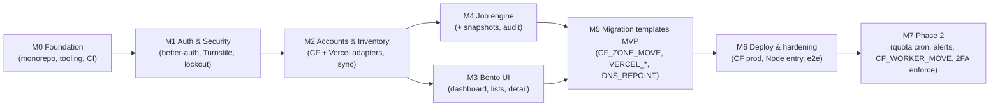

# Kế hoạch: freetier-loop: trang admin chuyển dữ liệu giữa các account free-tier

> Tài liệu sống. Rule cho agent: [`AGENTS.md`](../AGENTS.md) + `.agents/rules/`. Task: [`TASKS.md`](./TASKS.md).
> Kết quả nghiên cứu API/giới hạn nền tảng: [`RESEARCH.md`](./RESEARCH.md).

## 1. Mục tiêu

Khi một account Cloudflare/Vercel/Supabase hết quota free, bạn cần **chuyển nhanh và an toàn** domain, DNS, project,
DB/Edge Functions, env/config sang account khác để chạy tiếp. Trang admin này dùng để:

1. **Quản lý nhiều account** của từng provider (**Cloudflare, Vercel, Supabase** trong MVP; sau này thêm Netlify, Render, Neon…), lưu token đã mã hóa.
2. **Kiểm kê (inventory)**: zone/domain (kèm trạng thái Cloudflare Registrar), DNS record, Worker/Pages, Vercel project (Hobby & Team), project domain, env var, Supabase project/org/Edge Functions/keys. Có sync và cache trong D1.
3. **Theo dõi quota**: lượng request/ngày (CF), số project active / dung lượng DB / cảnh báo sắp bị auto-pause 7 ngày (Supabase), trạng thái account. Cảnh báo hiển thị ngay trong dashboard (in-app, chưa cần Telegram/Email/Discord).
4. **Migration/transfer có hướng dẫn**: tự động chọn strategy phù hợp (vd: CF Registrar vs registrar ngoài, Vercel Team transfer vs Hobby recreate, Supabase org transfer vs recreate sang user khác + tạo lệnh `pg_dump`/`psql` + tự cập nhật `SUPABASE_URL`/key sang Vercel/CF), chạy thử (dry-run, xem diff) → xác nhận → chạy từng bước. Có snapshot, log, chạy lại được (resumable) và idempotent.
5. **Snapshot và audit**: mọi thay đổi đều có bản backup cấu hình và nhật ký.

**Không làm (MVP):** đăng ký tài khoản, nhiều tenant, chuyển dữ liệu D1/KV/R2/Supabase Storage (để sang Phase 3), thông báo ngoài app (Telegram/Email/Discord).

## 2. Thực tế nền tảng ảnh hưởng tới thiết kế

| Ràng buộc | Cách xử lý trong thiết kế |
|---|---|
| **Domain ở Cloudflare Registrar (trường hợp chính của bạn):** NS bị khóa ở Cloudflare, **không được xóa zone** như registrar ngoài; chuyển đăng ký tên miền phải qua luồng Move/Support ticket và bên nhận xác nhận. | Template `CF_REGISTRAR_DOMAIN_MOVE`: tạo trước zone + import DNS bằng batch ở account đích (không phá dữ liệu nguồn) → tắt DNSSEC → bước thủ công có hướng dẫn chi tiết (move/ticket + xác nhận) → poll tới khi zone đích `active`. Với domain ở registrar ngoài thì vẫn có `CF_ZONE_MOVE` (xóa → tạo → đổi NS). Hệ thống tự phát hiện qua `GET /accounts/{id}/registrar/domains`. |
| Worker secret (CF), env `sensitive` (Vercel) và function secrets (Supabase) **chỉ ghi, không đọc lại được**. | Đánh dấu `MANUAL_INPUT_REQUIRED`. UI có form để nhập lại giá trị. Không giả vờ copy. |
| **Vercel có cả Hobby và Team:** transfer project native chỉ chạy khi cả 2 bên có quyền team; **Hobby ↔ Hobby không hỗ trợ**. | Strategy resolver tự kiểm tra loại account (`accountType: hobby \| team`) và quyền: nếu đủ điều kiện → `VERCEL_PROJECT_TRANSFER` (nhanh, giữ nguyên history); nếu vướng Hobby → `VERCEL_PROJECT_RECREATE` (tạo lại từ git repo, copy env đọc được, chuyển domain, deploy). |
| **Supabase free giới hạn 2 active project / user** (tính gộp mọi org mà user làm Owner/Admin; project `paused` không tính) và **auto-pause sau 7 ngày không hoạt động**. | (1) Nút **Pause / Restore** nhanh ngay trên UI để giải phóng slot. (2) Chuyển giữa 2 org cùng user → `SUPABASE_ORG_TRANSFER` (`/v2/projects/:ref/transfers`). (3) Hết slot thật sự → phải chuyển sang **account của user khác** (PAT khác) bằng `SUPABASE_PROJECT_RECREATE`: tạo project mới + copy Edge Functions & config qua API + sinh sẵn lệnh `pg_dump`/`psql` để bạn chạy 1 dòng trên máy (Worker không chạy được `pg_dump`) + verify số dòng từng bảng qua `/v1/projects/:ref/database/query` + bước `ENV_REWIRE` tự đẩy `SUPABASE_URL`/anon/service key mới sang project Vercel/Cloudflare liên quan. |
| Workers free: **50 subrequest/request**, CPU khoảng 10 ms. | Job engine chạy **mỗi request một bước (hoặc một chunk)**. Ưu tiên API batch (`dns_records/batch`). Hash password bằng `node:crypto` native. |
| D1 không có interactive transaction. | Dùng `db.batch()`. Thiết kế step idempotent. |

## 3. Kiến trúc

- **Monorepo pnpm**: `apps/web`, `apps/api`, `packages/shared` (constants, Zod schema, type), `packages/db` (Drizzle schema, migration, seed), `packages/config`.
- **Portability**: Hono app thuần (`createApp(deps)`). Runtime entry tách riêng (`entries/cloudflare.ts`, `entries/node.ts`). DB dùng Drizzle sqlite-core nên chạy được trên D1, libSQL/Turso hoặc SQLite. Crypto dùng WebCrypto. Muốn chuyển sang Docker/Fly/VPS thì chỉ cần thêm entry và adapter.
- **Type-safe end-to-end**: Hono RPC (`hc<AppType>`) + Zod schema dùng chung giữa API và form.

### 3.1 Phân lớp backend
`routes (validate/HTTP) → services (nghiệp vụ) → repositories (Drizzle) | providers (HTTP ngoài)`.
Service nhận `Deps` qua DI nên dễ test bằng fake. Provider được chia theo **capability** nhỏ (ISP) và đăng ký vào registry (OCP).

```mermaid
classDiagram
  class ProviderAdapter { +id: Provider +capabilities() }
  class AccountVerifier { <<interface>> +verify(cred) }
  class ZoneProvider { <<interface>> +listZones() +createZone() +deleteZone() +getZone() }
  class RegistrarDomainProvider { <<interface>> +listRegistrarDomains() }
  class DnsRecordProvider { <<interface>> +listRecords() +exportRecords() +batchApply() }
  class ProjectProvider { <<interface>> +listProjects() +getProject() +transfer() +create() +pause() +restore() }
  class ProjectDomainProvider { <<interface>> +list() +add() +remove() +verify() }
  class EnvVarProvider { <<interface>> +list() +upsert() }
  class EdgeFunctionProvider { <<interface>> +list() +download() +deploy() }
  class SqlQueryProvider { <<interface>> +queryReadOnly() }
  class UsageProvider { <<interface>> +getUsage(range) }
  ProviderAdapter <|-- CloudflareAdapter
  ProviderAdapter <|-- VercelAdapter
  ProviderAdapter <|-- SupabaseAdapter
  CloudflareAdapter ..|> AccountVerifier
  CloudflareAdapter ..|> ZoneProvider
  CloudflareAdapter ..|> RegistrarDomainProvider
  CloudflareAdapter ..|> DnsRecordProvider
  CloudflareAdapter ..|> UsageProvider
  CloudflareAdapter ..|> ProjectDomainProvider
  VercelAdapter ..|> AccountVerifier
  VercelAdapter ..|> ProjectProvider
  VercelAdapter ..|> ProjectDomainProvider
  VercelAdapter ..|> EnvVarProvider
  SupabaseAdapter ..|> AccountVerifier
  SupabaseAdapter ..|> ProjectProvider
  SupabaseAdapter ..|> EnvVarProvider
  SupabaseAdapter ..|> EdgeFunctionProvider
  SupabaseAdapter ..|> SqlQueryProvider
  SupabaseAdapter ..|> UsageProvider
```

## 4. Mô hình dữ liệu (D1)

Bảng auth (`user`, `session`, `account`, `verification`, `rate_limit`, `two_factor`) được sinh bằng `@better-auth/cli generate`.

## 5. Auth và bảo mật

- **Không có đăng ký**: `disableSignUp: true`. Admin chỉ được tạo bằng CLI `pnpm db:seed:admin --email --password` (cả local lẫn remote).
- **Giới hạn đăng nhập** (nhiều lớp):
  1. Allowlist `ADMIN_EMAILS`: email ngoài danh sách bị từ chối ngay cả khi có user trong DB.
  2. Turnstile trên `/sign-in/email`.
  3. Rate limit của better-auth (lưu trong DB): 5 lần/60s/IP cho sign-in.
  4. Lockout: sai 5 lần liên tiếp thì khóa 15 phút (bảng `login_attempts`).
  5. 2FA TOTP (plugin `twoFactor`) tùy chọn, có thể bắt buộc qua `REQUIRE_2FA`.
  6. Session TTL 7 ngày, sliding; có trang "Sessions" để revoke.
- **Token provider**: mã hóa AES-256-GCM bằng `ENCRYPTION_KEY`, hỗ trợ xoay key, client chỉ thấy `****last4`.
- **Header**: CSP chặt (cho phép `challenges.cloudflare.com`), HSTS, `frame-ancestors 'none'`.

## 6. API (v1)

| Method | Path | Mô tả |
|---|---|---|
| ALL | `/api/auth/*` | better-auth (sign-in, sign-out, session, 2FA) |
| GET | `/api/v1/health` | public |
| GET | `/api/v1/dashboard/summary` | dữ liệu cho bento dashboard |
| GET/POST | `/api/v1/provider-accounts` | list / thêm account (verify token) |
| GET/PATCH/DELETE | `/api/v1/provider-accounts/:id` | chi tiết / sửa label, quota, rotate token / xóa |
| POST | `/api/v1/provider-accounts/:id/verify` | kiểm tra token và quyền |
| POST | `/api/v1/provider-accounts/:id/sync` | sync inventory (chunked, trả về `cursor`) |
| GET | `/api/v1/provider-accounts/:id/usage` | quota/usage |
| GET | `/api/v1/resources?accountId&kind&q` | inventory (domain, project…) |
| GET | `/api/v1/resources/:id` | chi tiết (DNS records, env, domains) |
| POST | `/api/v1/resources/:id/snapshots` | tạo snapshot thủ công |
| GET | `/api/v1/snapshots/:id` · `/download` | xem / tải JSON (hoặc BIND cho zone) |
| GET | `/api/v1/migration-templates` | danh sách template và input schema |
| POST | `/api/v1/jobs` | tạo job (draft) |
| POST | `/api/v1/jobs/:id/plan` | dry-run, sinh plan/diff |
| POST | `/api/v1/jobs/:id/confirm` | xác nhận (typed confirm) |
| POST | `/api/v1/jobs/:id/advance` | chạy bước/chunk tiếp theo |
| POST | `/api/v1/jobs/:id/steps/:stepId/manual-input` | nhập secret / xác nhận đã đổi NS |
| POST | `/api/v1/jobs/:id/cancel` · `/retry` | hủy / chạy lại bước lỗi |
| GET | `/api/v1/jobs` · `/:id` · `/:id/events` | danh sách / chi tiết / timeline |
| GET | `/api/v1/audit-logs` | nhật ký |
| GET/PATCH | `/api/v1/settings` | ngưỡng cảnh báo, 2FA… |

## 7. Migration templates

Hệ thống có **Strategy Resolver**: khi bạn chọn một resource để chuyển, hệ thống kiểm tra metadata (zone có thuộc Cloudflare Registrar không, account Vercel là Hobby hay Team, 2 account Supabase có cùng user/org không) và tự đề xuất template tối ưu.

| Template | Khi nào dùng | Các bước chính | Thủ công |
|---|---|---|---|
| `CF_REGISTRAR_DOMAIN_MOVE` *(mặc định cho domain của bạn)* | Zone mua tại **Cloudflare Registrar** | preflight (token 2 bên, domain > 10 ngày, tắt DNSSEC) → snapshot đầy đủ → tạo zone ở đích + batch import DNS + settings khả dụng (**không xóa nguồn**) → hướng dẫn chuyển đăng ký tên miền (dashboard/ticket + xác nhận email Super Admin đích) → poll zone đích `active` → re-bind Worker/Pages domains → verify | thao tác move/ticket CF Registrar |
| `CF_ZONE_MOVE` | Zone ở registrar ngoài (Namecheap, GoDaddy…) | preflight (DNSSEC off) → snapshot → delete source → create target (`jump_start:false`) → batch restore DNS → restore settings → manual đổi NS tại registrar → poll `active` → verify | đổi NS tại registrar |
| `CF_WORKER_MOVE` | Chuyển Worker | snapshot script + bindings metadata → upload script sang đích → nhập lại secrets → chuyển custom domain/route → verify | secrets |
| `VERCEL_PROJECT_TRANSFER` | Cả 2 bên có quyền Team | preflight membership → tạo `transfer-request` → accept bằng token đích → verify domain/env | – |
| `VERCEL_PROJECT_RECREATE` | Có ít nhất 1 bên là **Hobby** | snapshot (settings, env, domains) → tạo project ở đích (cùng git repo) → upsert env đọc được → nhập env `sensitive` → gỡ domain ở nguồn → thêm domain ở đích → verify TXT nếu cần → trigger deploy → verify | env `sensitive`, quyền Git |
| `VERCEL_DOMAIN_MOVE` | Chuyển lẻ domain Vercel | gỡ khỏi project/account nguồn → add ở đích → verify | TXT (nếu được yêu cầu) |
| `SUPABASE_ORG_TRANSFER` | Chuyển giữa 2 org **cùng user** | `POST /v2/projects/:ref/transfers/previews` → `POST /v2/projects/:ref/transfers` → verify (lưu ý: không giảm số active project của user đó) | – |
| `SUPABASE_PROJECT_RECREATE` | Chuyển sang **user account khác** khi hết 2 slot free | snapshot (config auth, danh sách bảng + số dòng, Edge Functions code, tên secrets) → tạo project mới ở đích → chạy lệnh `pg_dump`/`psql` do hệ thống sinh sẵn → verify số dòng từng bảng qua API `database/query` → deploy toàn bộ Edge Functions sang đích → nhập lại function secrets → chạy `ENV_REWIRE` cập nhật `SUPABASE_URL`/key sang project Vercel/CF → (tùy chọn) pause project cũ | chạy 1 lệnh `pg_dump \| psql`, nhập DB password + function secrets |
| `DNS_REPOINT` | Đổi DNS trỏ sang deployment mới | batch patch các record A/CNAME/TXT trên Cloudflare, có plan diff và rollback | – |
| `ENV_REWIRE` | Đổi biến môi trường hàng loạt sau khi chuyển backend (vd Supabase mới) | cập nhật `SUPABASE_URL`, `NEXT_PUBLIC_SUPABASE_URL`, `SUPABASE_ANON_KEY`, `SUPABASE_SERVICE_ROLE_KEY`… trên project Vercel/CF đã liên kết → trigger redeploy | – |

Vòng đời job:

## 8. Giao diện (Bento grid)

- **Layout**: sidebar thu gọn được (Dashboard, Accounts, Domains, Projects, Migrations, Snapshots, Audit, Settings), topbar có Command palette (`⌘K`) và nút đổi theme.
- **Dashboard (bento)**:

| Card | Size |
|---|---|
| Quota tổng quan (bar/gauge mỗi account, đỏ khi > 80%) | `xl` |
| Account health (verify OK/invalid/quota_exceeded) | `md` |
| Domains summary (số zone theo account, pending NS) | `md` |
| Running / waiting jobs (CTA "tiếp tục") | `lg` |
| Recent audit | `md` |
| Quick actions: Add account · New migration · Sync all | `sm`×3 |

- **Migration wizard**: chọn template → nguồn/đích → chọn resource → **diff/plan** (bento các bước, badge manual/destructive) → gõ tên resource để confirm → **timeline** chạy bước, hiển thị form manual input ngay trong card.
- **Stack UI**: Tailwind v4 + shadcn/ui + lucide + `motion` (hover/enter nhẹ) + Recharts cho quota chart. Dark mode là mặc định.

## 9. Cấu hình và môi trường

| Biến | Nơi | Ghi chú |
|---|---|---|
| `BETTER_AUTH_SECRET` | secret | ≥ 32 bytes |
| `BETTER_AUTH_URL` | var | base URL công khai |
| `ADMIN_EMAILS` | var | danh sách phân tách bằng dấu phẩy |
| `TURNSTILE_SECRET_KEY` | secret | |
| `VITE_TURNSTILE_SITE_KEY` | build var (web) | |
| `ENCRYPTION_KEY` / `ENCRYPTION_KEY_PREVIOUS` | secret | base64 32 bytes |
| `REQUIRE_2FA` | var | `false` |
| `TRUSTED_ORIGINS`, `WEB_ORIGIN` | var | dùng khi tách origin |
| `DB` | D1 binding | |
| `VITE_API_BASE_URL` | build var | mặc định `/api` |

`wrangler.jsonc`: `main=apps/api/src/entries/cloudflare.ts`, `compatibility_flags=["nodejs_compat"]`,
`assets={directory:"apps/web/dist", not_found_handling:"single-page-application", run_worker_first:["/api/*"]}`,
`d1_databases=[{binding:"DB"}]`, `triggers.crons=["*/30 * * * *"]` (sync usage và cảnh báo, Phase 2).

## 10. Lộ trình (milestones)

Chi tiết từng task, thứ tự phụ thuộc và tiêu chí nghiệm thu nằm trong [`TASKS.md`](./TASKS.md).

## 11. Rủi ro và cách giảm

| Rủi ro | Mức | Giảm thiểu (tự động ngầm, không gây phiền khi thao tác) |
|---|---|---|
| **Tự khóa chính trang Admin (Self-lockout)** khi lỡ tay move/xóa chính zone/worker chạy Admin | Cao | Preflight tự động so khớp với `BETTER_AUTH_URL` / `SELF_PROTECTED_HOSTS` và chặn bằng mã lỗi `RESOURCE_SELF_PROTECTED`. Khuyến nghị đặt trang Admin ở 1 account Cloudflare riêng biệt không chạy app ăn quota. |
| **Downtime hoặc đứt gánh giữa đường (Split-brain)** | Cao | **Thứ tự Blue-Green (Tạo & kiểm tra sống ở đích trước → Cắt nguồn cuối cùng):** với Vercel/Supabase/CF Registrar, tạo xong ở đích, deploy và verify OK rồi mới gỡ custom domain / đổi `SUPABASE_URL`. Có nút **Emergency Restore** từ snapshot nếu bước cắt lỗi. |
| **Lỗi `ERR_TOO_MANY_REDIRECTS` hoặc rớt Email sau khi chuyển Zone CF** | Cao | Snapshot & tự đồng bộ luôn cấu hình SSL/TLS (`ssl=full/strict`, `always_use_https`, `min_tls_version`, `automatic_https_rewrites`). Preflight kiểm tra Email Routing và cảnh báo nếu đang bật. |
| **Thiếu dữ liệu `auth.users`, `storage`, `pg_extension` hoặc gãy OAuth/Webhook khi chuyển Supabase** | Cao | Lệnh `pg_dump` tự động bao gồm `--schema=public --schema=auth --schema=storage`; preflight liệt kê các `pg_extension` cần bật ở đích và danh sách biến `WEBHOOK`/`CALLBACK`/OAuth URL cần cập nhật. |
| **Vercel báo trùng Git repo giữa 2 account Hobby** | TB | Trong `VERCEL_PROJECT_RECREATE`, nếu API tạo project ở đích báo repo đã gắn ở nguồn, step sẽ tự động ngắt liên kết Git ở project nguồn trước (source vẫn giữ nguyên deployment đang chạy) rồi gắn vào đích. |
| **Lộ giá trị nhạy cảm nằm trong biến env thường (plain env) khi lưu Snapshot** | Cao | Mã hóa AES-256-GCM cho toàn bộ giá trị env var trong `snapshots` / `job_steps`; khi tải file JSON về máy mặc định che (`******`). |
| **Token lộ** | Cao | AES-256-GCM bằng `ENCRYPTION_KEY`, không bao giờ log, xoay key, chỉ cần đăng nhập Admin bình thường + gõ tên resource để xác nhận (ưu tiên tiện lợi nhanh gọn, không bắt nhập lại mật khẩu/passphrase mỗi lần). |
| **Vượt CPU/subrequest của free plan hoặc bị rate-limit** | TB | Job chia nhỏ từng bước, batch API, jitter khi sync nhiều account, hash password bằng `node:crypto`. |

## 12. Quyết định đã chốt (ADR rút gọn)

1. **better-auth** thay vì Auth.js: tích hợp Hono/Workers tốt, có sẵn captcha Turnstile, rate limit, disableSignUp, 2FA.
2. **Một Worker** phục vụ cả SPA lẫn API: cùng origin nên không cần CORS và cookie đơn giản. Vẫn tách được origin nhờ config.
3. **Drizzle sqlite-core**: chạy được trên D1, libSQL và SQLite.
4. **TanStack Router + Query**: type-safe và hợp với Hono RPC.
5. **Biome** thay ESLint + Prettier: nhanh, một tool.
6. **Job chạy theo từng bước, do client/cron gọi `advance`**: hợp với giới hạn free plan. Sau này có thể thay bằng Cloudflare Workflows/Queues qua interface `JobRunner`.

## 13. Các điểm bạn đã chốt (2026-11-07)

1. **Vercel**: có cả **Hobby và Team** → hỗ trợ cả 2 template (`VERCEL_PROJECT_TRANSFER` và `VERCEL_PROJECT_RECREATE`) kèm Strategy Resolver tự chọn.
2. **Domain**: trước mắt đều ở **Cloudflare Registrar** → ưu tiên `CF_REGISTRAR_DOMAIN_MOVE` (chuẩn bị zone đích trước, không xóa zone nguồn, hướng dẫn bước move registrar); vẫn giữ `CF_ZONE_MOVE` cho domain registrar ngoài sau này.
3. **Providers trong MVP**: **Cloudflare + Vercel + Supabase** (quản lý project, pause/restore giải phóng slot, cảnh báo auto-pause 7 ngày, chuyển org hoặc recreate sang account khác + copy Edge Functions + lệnh `pg_dump`/`psql` + tự cập nhật env `SUPABASE_*` sang Vercel/CF).
4. **Domain của trang admin**: bạn sẽ cung cấp sau → chỉ cần ở bước deploy production (`T-110`). Toàn bộ quá trình code/test local dùng `http://localhost:8787` và Turnstile test key.
5. **Thông báo ngoài app (Telegram/Discord/Email)**: chưa cần → chỉ làm cảnh báo hiển thị trong dashboard.
6. **Trải nghiệm bảo mật**: **ưu tiên tiện lợi, nhanh gọn** — chỉ cần đăng nhập Admin bình thường (kèm Turnstile + allowlist + rate-limit) và lưu 1 token đầy đủ quyền đã mã hóa AES-256-GCM; **không** bắt nhập lại mật khẩu (step-up auth) hay Vault Passphrase mỗi phiên. Các lớp bảo vệ an toàn (chống tự xóa trang Admin, thứ tự Blue-Green, đồng bộ SSL/TLS mode, mã hóa env trong snapshot, đầy đủ schema `auth`/`storage` cho Supabase) được xử lý **tự động ngầm ở tầng hệ thống**.

